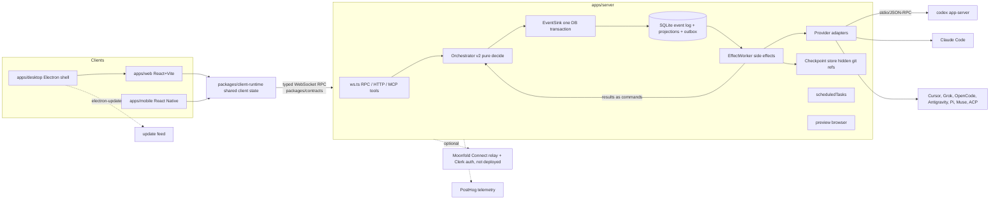

# Moonfold architecture (inherited from T3 Code)

Source: `docs/internals/overview.md`, `AGENTS.md`, and the code. Moonfold keeps this architecture; deviations go in DECISIONS.md.

## Workspace layout

- `apps/server`: WebSocket server, orchestration v2, providers, checkpoints, scheduled tasks, MCP toolkits, preview browser, usage, cloud/relay.
- `apps/web`, `apps/desktop`, `apps/mobile`, `apps/marketing`.
- `packages/contracts` (Effect/Schema wire types), `shared`, `client-runtime`, `provider-*` (core, acp, cursor, grok, opencode, pi, muse, testing), `effect-codex-app-server`, `effect-acp`, `source-control-*`, `ssh`, `tailscale`.

## Key facts for Moonfold

- **Source of truth is already an event log** (`orchestration-v2`): commands decided purely, events committed with projections and outbox in one transaction, side effects after commit. This matches our "provider sessions are caches" decision; Phase 4 extends it rather than adding a second log.
- **Provider adapter boundary**: `docs/internals/adding-a-provider.md`, `providers.md`. Codex adapter uses `packages/effect-codex-app-server` over `codex app-server` stdio.
- **Handoff already exists in basic form**: `ContextHandoffServiceV2` builds a budgeted textual selection when switching providers (`docs/internals/context-handoffs.md`, `docs/user/portable-handoffs.md`). It has no limit-triggered switching, plan/diff/open-problem brief, redaction or preview. Phase 4 builds on it.
- **Checkpoints** are hidden git refs per turn; revert must coordinate workspace and provider conversation.
- **Hosted dependencies** to remove or replace in Phase 1: see NETWORK-AUDIT.md.
- **Update mechanism**: `electron-updater` in `apps/desktop/src/electron/ElectronUpdater.ts`, manifests built in `.github/workflows/release.yml`.
